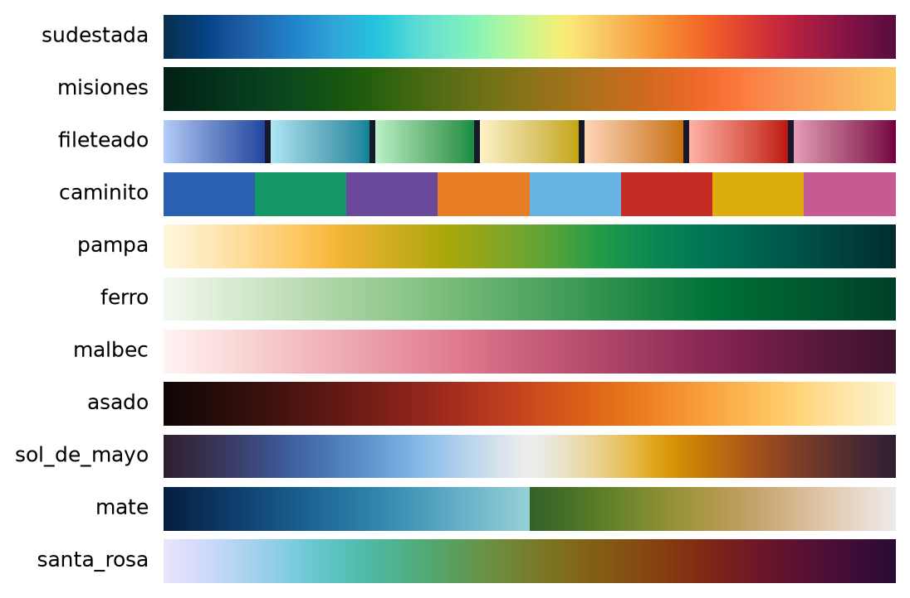
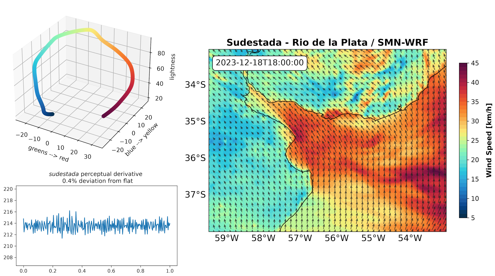
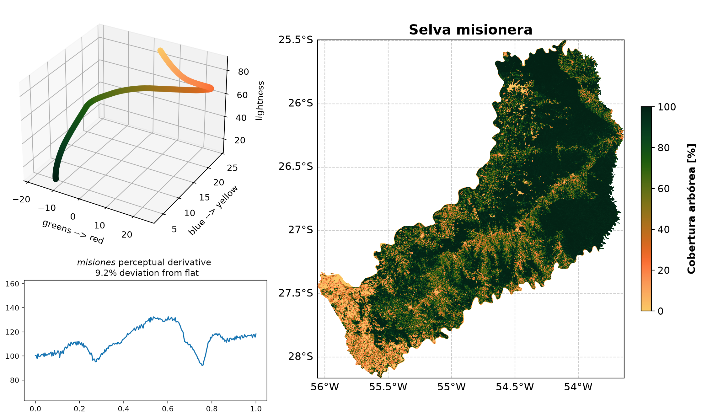
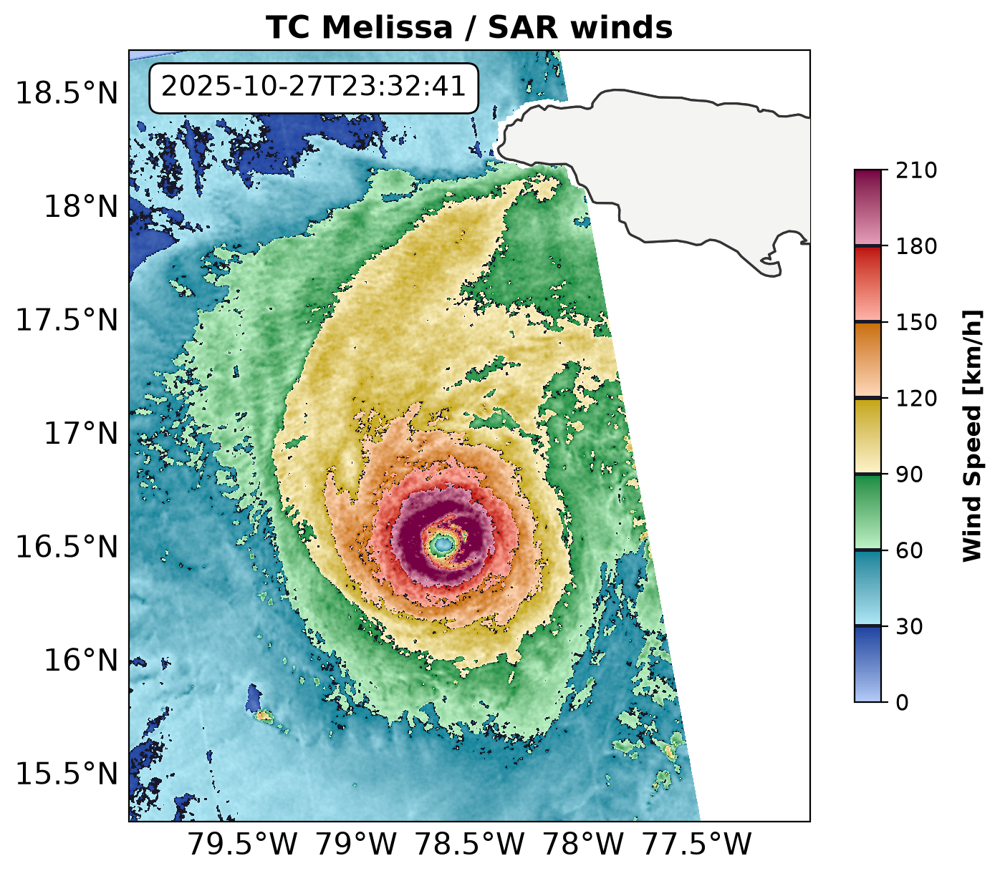
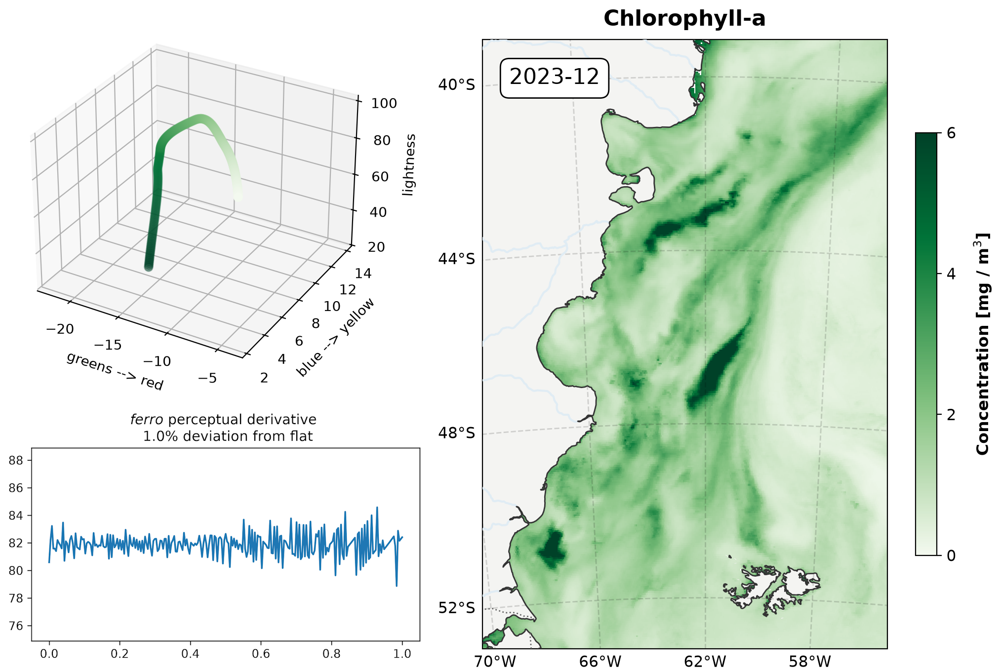
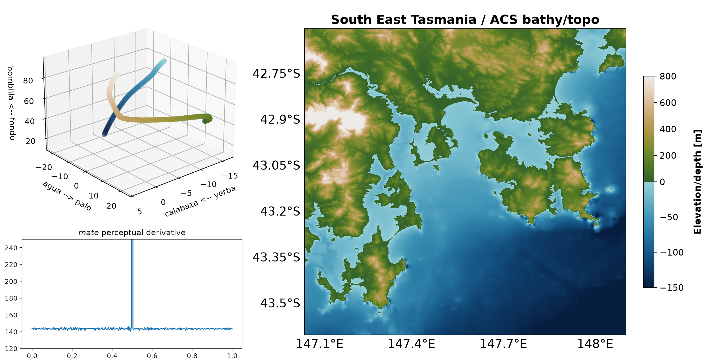
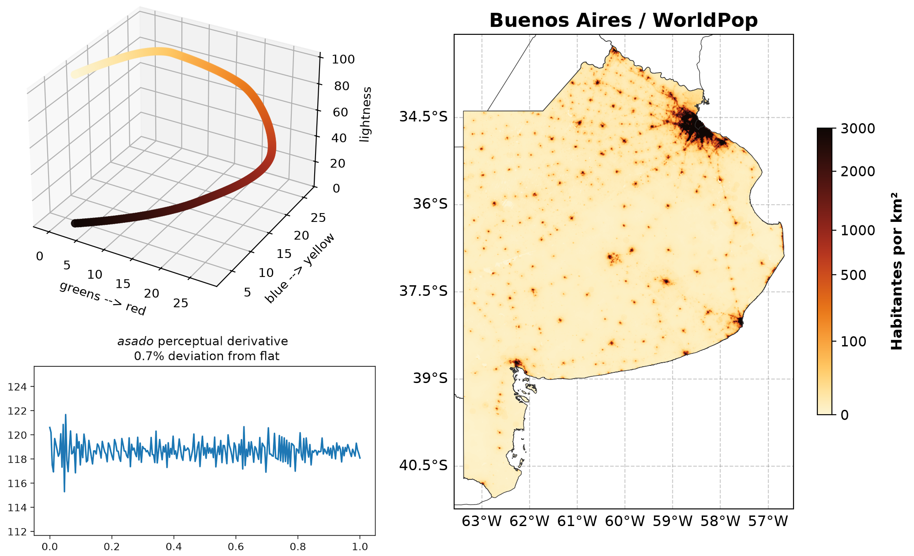
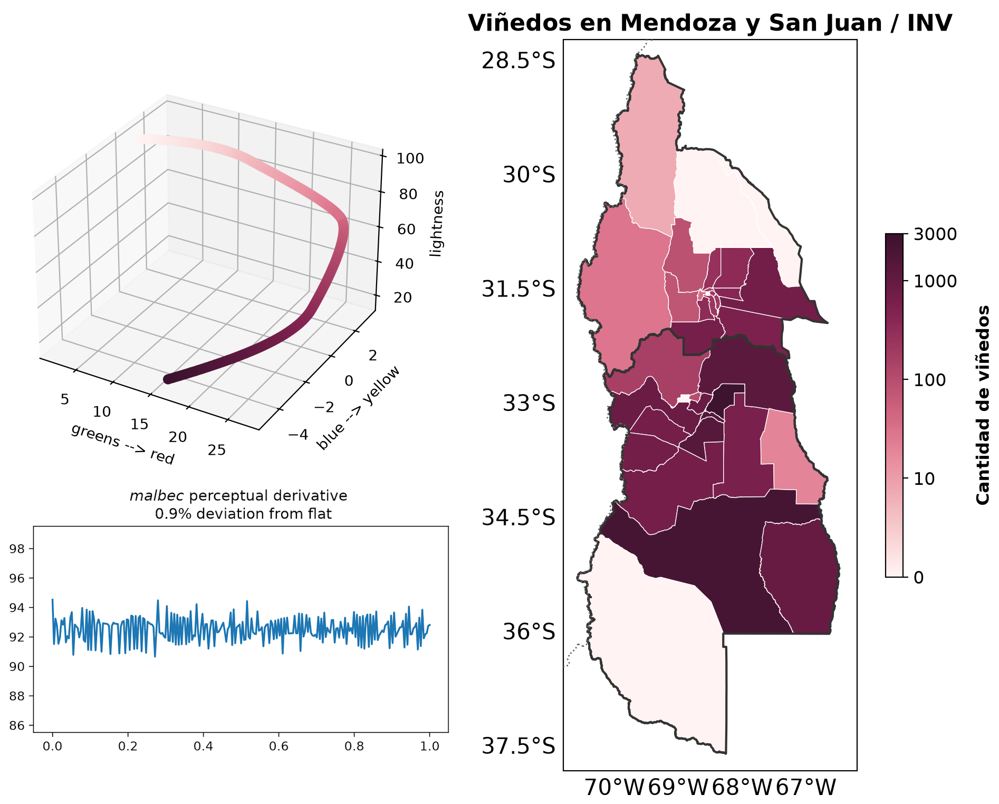
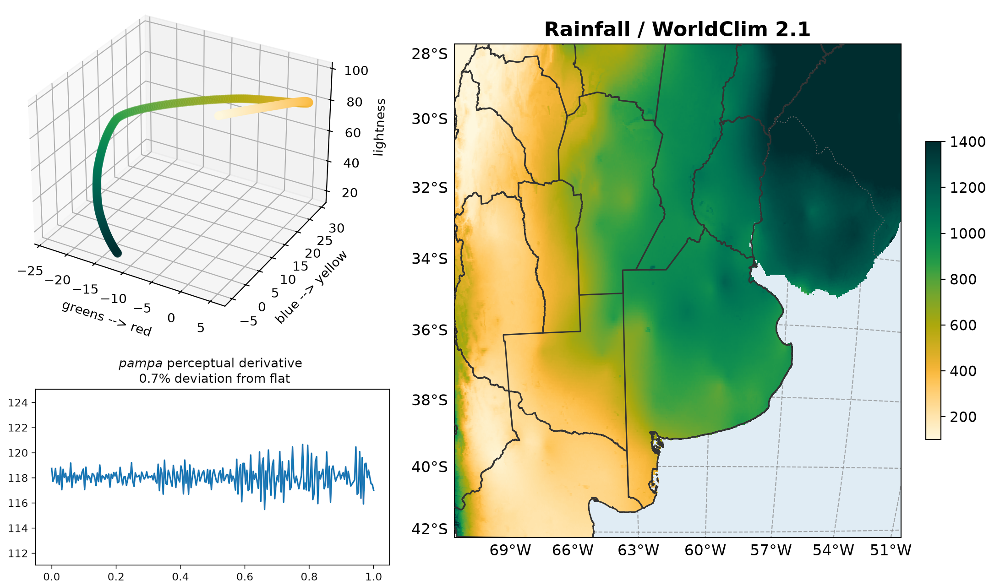
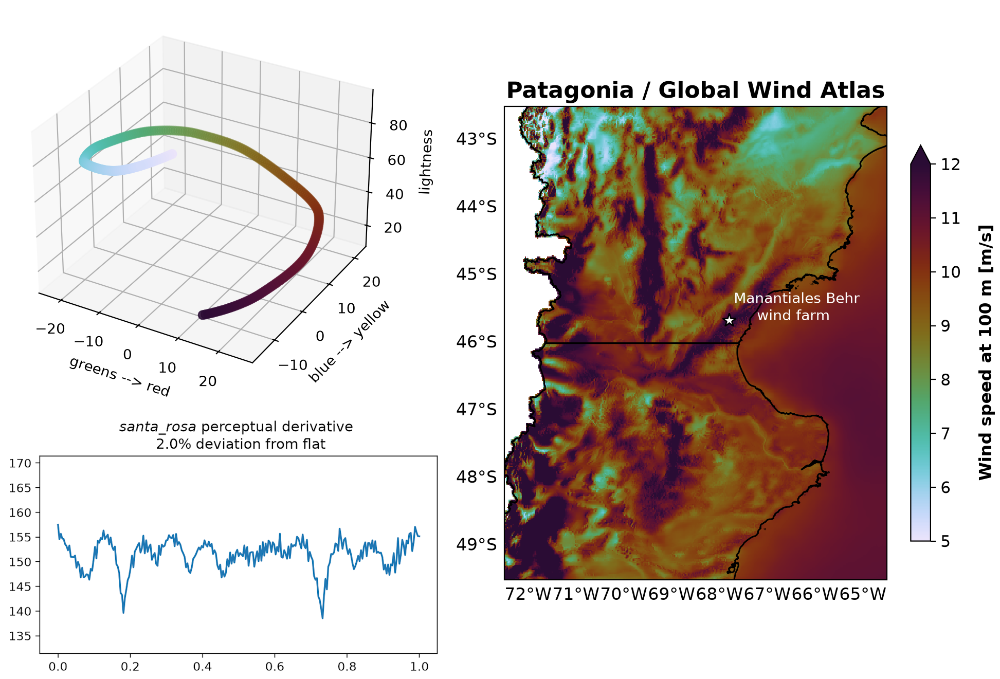

# cmargentina

Colormaps argentinas para matplotlib

```bash
pip install cmargentina
```

```python
import cmargentina
plt.pcolormesh(x, y, z, cmap="sudestada")  # o cmargentina.sudestada, "sudestada_r"
```

```python
cmargentina.show()
```


## sudestada

https://en.wikipedia.org/wiki/Sudestada



## misiones

https://en.wikipedia.org/wiki/Misiones_Province



(Data from University of Maryland's Global Forest Change 2000-2024 (Hansen et al., 2013))

## fileteado

https://en.wikipedia.org/wiki/Fileteado



## ferro

https://es.wikipedia.org/wiki/Club_Ferro_Carril_Oeste



## mate

https://en.wikipedia.org/wiki/Mate_(drink)



## asado

https://en.wikipedia.org/wiki/Asado



## malbec

https://en.wikipedia.org/wiki/Malbec



## pampa

https://en.wikipedia.org/wiki/Pampas



## santa_rosa

https://es.wikipedia.org/wiki/Tormenta_de_Santa_Rosa

